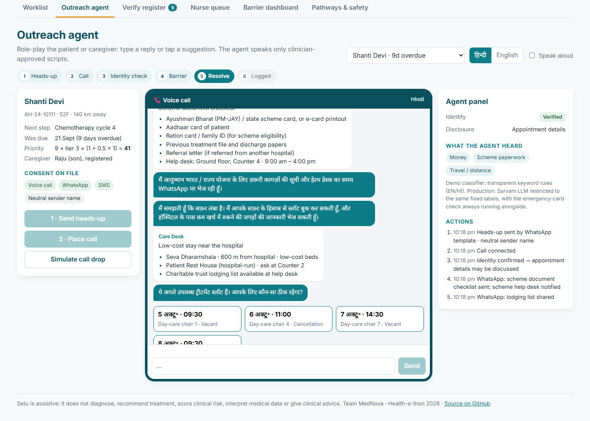

# Setu
### Cancer Treatment Dropout Recovery

*Reminders don't bring patients back. Removing their barrier does.*

**[Live demo](https://hannielvinu.github.io/Setu/)** · Health-a-thon 2026 · Team MedNova

`Track: Cancer` · `Primary user: Doctor / Care Team` · `Use case: Patient Follow-up & Continuity of Care`

## The problem

Cancer patients in India often drop out between treatment steps such as chemotherapy cycles, radiotherapy reviews and follow-up visits. Many of the reasons are non-clinical: cost, paperwork, travel and family responsibilities. Care teams find these patients by hand, and the reason a patient left is rarely recorded.

## What Setu does

Setu is an **assistive** follow-up agent for hospital care teams. It helps them:

1. **Find** patients who have missed a planned step in their care pathway
2. **Reach** them, or their registered caregiver, in their own language
3. **Understand** what is stopping them from returning
4. **Resolve** the barrier with the care team, or hand over to a person
5. **Measure** who comes back, and why patients drop out

## Principles

- **Assistive, not clinical:** no diagnosis, treatment advice, clinical decision support or risk scoring. Anything clinical goes to people.
- **Clinician in control:** the care team owns the pathways and the messages.
- **Privacy first:** consent-based outreach with identity checks before any detail is shared.
- **Works with what hospitals already have:** no EMR integration needed.

## Status

A working prototype with **synthetic data** and a fictional hospital is live at **https://hannielvinu.github.io/Setu/**. A pilot with a partner hospital is planned, measuring return to care within 60–90 days.

### Try the Round 2 workflow

[Watch the narrated walkthrough](https://hannielvinu.github.io/Setu/round2-demo.mp4).

1. Open the live demo (no login). In **Worklist**, start outreach for **Shanti Devi**.
2. Switch to **English**, send the heads-up, place the simulated call, select the patient reply, then select **1974**.
3. Choose the reply about an expired Ayushman card and bus fare. Review the simulated checklist and lodging information, then select a slot.
4. Go back to the worklist. **Rebooked** means attendance is still pending. Choose **Record attendance** and **Confirm simulated check-in** to record return to care separately. The barrier dashboard shows the confirmed return count.
5. Reset and repeat with “I feel weak and the bus fare is too much.” The demo creates a nurse review and offers no slot. Wrong identity and STOP are useful additional controls.

The browser runs the rules, sample scripts, queue, slot allocation and attendance workflow. The demo uses local browser storage and fictional records. Calls, SMS and WhatsApp are simulated, as are the OCR samples; CSV parsing and row review run locally. The public demo does not call a cloud AI model, contact a hospital or accept real patient records. Imports have no outreach consent by default.

Run locally from `app` with `npm ci` and `npm run dev`. Run `npm test` for the engine and state checks and `npm run build` for the production bundle.

## Team

**Team MedNova**: a doctor-led team of clinicians and technologists, building for Health-a-thon 2026.

---

© 2026 Team MedNova. All rights reserved. See [LICENSE](LICENSE). All names and records in the demo are fictional.
